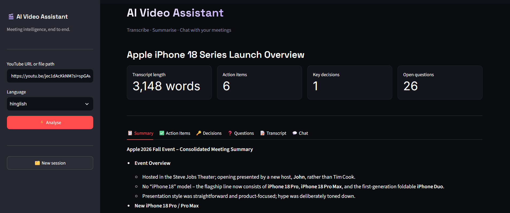
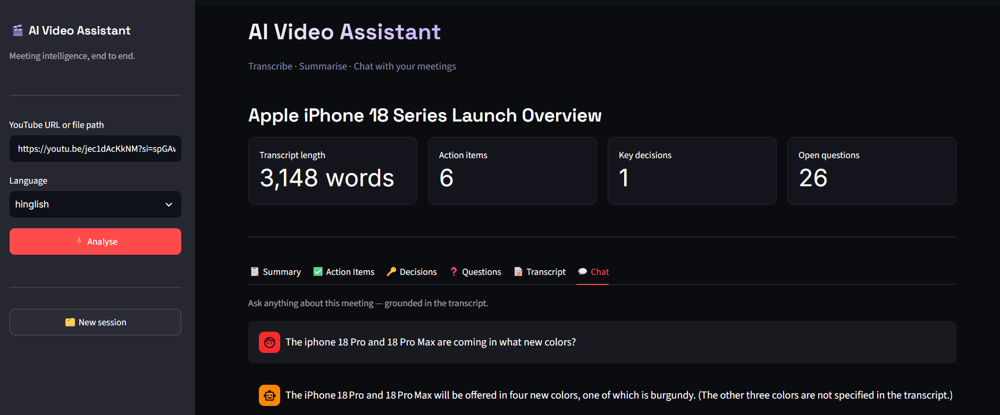
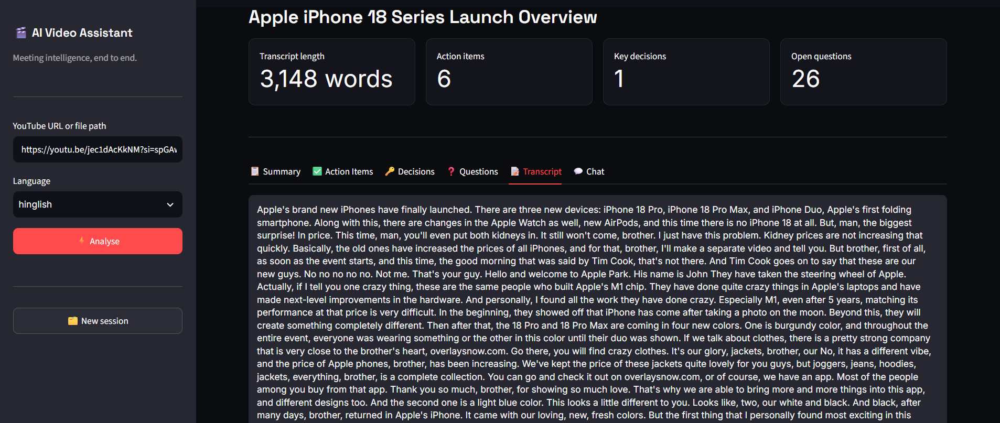
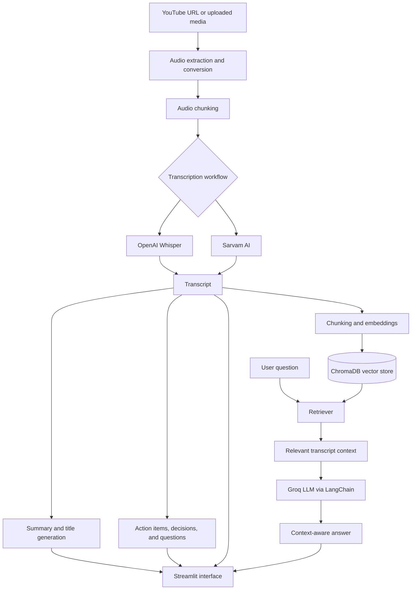

# 🎥 AI Meeting / Video Assistant — RAG

> Turn long meeting recordings into searchable, actionable knowledge.

An AI-powered meeting intelligence application that processes YouTube videos and uploaded audio/video files, transcribes speech, generates structured meeting insights, and lets users ask context-aware questions about the recording through Retrieval-Augmented Generation (RAG).

## Overview

Meetings and recorded discussions often contain decisions, commitments, deadlines, and unresolved questions that are difficult to find by replaying an entire recording. This project automates the process of converting recordings into structured notes and a conversational knowledge source.

Provide a YouTube URL or upload an audio/video file. The application prepares the audio, transcribes speech, summarizes the discussion, extracts meeting details, and builds a retrieval pipeline so users can ask questions grounded in the transcript.

## Application Screenshots

### Home Page


### Chat


### Transcript


## Features

### 🎬 Multiple input sources

- Accepts YouTube URLs.
- Supports uploaded audio and video files.
- Extracts and converts audio for transcription using `yt-dlp`, FFmpeg, and audio-processing utilities.
- Splits long recordings into manageable audio chunks.

### 🎙️ Speech transcription

| Input workflow | Technology |
| --- | --- |
| English audio | OpenAI Whisper |
| Hindi / Hinglish workflow | Sarvam AI |

The transcription workflow depends on the language selected and the configuration available to the application.

### 🧠 Automated meeting intelligence

- **Meeting summary:** produces a concise overview of the main discussion points.
- **Action items:** identifies tasks and, when stated in the transcript, associated owners and deadlines.
- **Key decisions:** extracts decisions reached during the discussion.
- **Open questions:** surfaces unresolved questions and potential follow-ups.
- **Meeting title:** generates a title to make the meeting easier to identify.
- **Report export:** provides structured meeting-report output where supported by the application.

### 💬 Conversational Q&A with RAG

- Splits the transcript into retrievable text chunks.
- Creates embeddings and stores them in ChromaDB.
- Retrieves relevant transcript context for a user question.
- Uses an LLM through LangChain and Groq to formulate a context-aware response.
- Helps users locate information without manually searching the full transcript.

### 🖥️ Interactive Streamlit interface

Explore the meeting output through separate views for the summary, action items, decisions, questions, transcript, and chat-based Q&A.

## Application workflow

1. **Input:** provide a YouTube URL or upload an audio/video file.
2. **Audio preparation:** download/extract audio where possible, convert it to a compatible WAV format, and split long recordings into chunks.
3. **Transcription:** generate transcript text using the selected speech-to-text workflow.
4. **Meeting analysis:** create the summary and extract action items, decisions, and open questions.
5. **Indexing:** split the transcript into chunks, generate embeddings, and index them in ChromaDB.
6. **Question answering:** retrieve relevant transcript chunks and pass the context to the language model.
7. **Results:** review the outputs and ask follow-up questions from the Streamlit interface.

## Architecture



## Tech-stack used

| Area | Technologies |
| --- | --- |
| Language and interface | Python, Streamlit |
| Audio/video ingestion | `yt-dlp`, FFmpeg, `pydub` |
| Speech-to-text | OpenAI Whisper, Sarvam AI |
| LLM inference | Groq |
| Orchestration | LangChain |
| Embeddings | Sentence Transformers / Hugging Face |
| Vector database | ChromaDB |
| Configuration | `python-dotenv`, Streamlit secrets |
| Deployment | Streamlit Community Cloud |

## Getting started

### Prerequisites

- Python 3.11 (recommended for the project configuration described here).
- Git.
- FFmpeg installed and available on your `PATH`.
- API keys for the services you plan to use: Groq and Sarvam AI.

Check that FFmpeg is available:

```bash
ffmpeg -version
```

### 1. Clone the repository

```bash
git clone https://github.com/satyam4312/AI-Meeting-Assistant-Using-RAG.git
cd AI-Meeting-Assistant-Using-RAG
```

### 2. Create and activate a virtual environment

**Windows PowerShell**

```powershell
py -3.11 -m venv .venv
.\.venv\Scripts\Activate.ps1
```

**macOS / Linux**

```bash
python3.11 -m venv .venv
source .venv/bin/activate
```

### 3. Install dependencies

```bash
python -m pip install --upgrade pip
pip install -r requirements.txt
```

If FFmpeg is not installed on your machine, install it using the package manager appropriate for your operating system, then restart the terminal and re-run `ffmpeg -version`.

### 4. Configure API keys

Create a local `.env` file in the repository root:

```env
GROQ_API_KEY=your_groq_api_key
SARVAM_API_KEY=your_sarvam_api_key
```

Replace the example values with your own keys. **Never commit `.env` or real API keys to GitHub.** The application code must load these values using its configured environment-variable or Streamlit-secrets mechanism.

## Run the application

From the activated virtual environment and repository root, run:

```bash
streamlit run app.py
```

Open the local URL printed in the terminal, usually `http://localhost:8501`.

For a first end-to-end test, upload a short audio/video file, check the transcript and extracted insights, then ask a question in the chat tab and verify that the answer is supported by the transcript.

## Deploy to Streamlit Community Cloud

1. Push the application code and `requirements.txt` to a GitHub repository.
2. Open [Streamlit Community Cloud](https://share.streamlit.io/) and connect the GitHub repository.
3. Choose the `main` branch and set the main file path to `app.py`.
4. In **Advanced settings**, select the Python version compatible with the project (Python 3.11 is the recommended target used in this README).
5. Add required secrets in the app's **Secrets** settings.
6. Deploy and review the application logs if the build or startup fails.

Example secrets in TOML format:

```toml
GROQ_API_KEY = "your_groq_api_key"
SARVAM_API_KEY = "your_sarvam_api_key"
```

Make sure the Python code reads Streamlit Cloud secrets with `st.secrets` or another mechanism supported by the app. Adding values to the Cloud Secrets panel does not make them available to code that only reads `os.getenv()` unless your application explicitly bridges that configuration.

### External Linux dependencies

The application uses FFmpeg for audio processing. Streamlit Community Cloud installs non-Python system packages from a root-level `packages.txt` file. If FFmpeg is required at runtime, keep this file committed and include:

```text
ffmpeg
```

Do **not** exclude `packages.txt` from Git if the deployment depends on it. The `.devcontainer/` directory is optional for Community Cloud deployment. You can choose the Python version in the deployment settings; a `.python-version` file is useful for some local tools but should not be relied upon as a substitute for selecting the deployment runtime.

## 📁 Project structure

The repository may include additional helper modules or configuration files; the main application components are organized around this structure:

```text
AI-Meeting-Assistant-Using-RAG/
├── app.py                       # Streamlit entry point
├── main.py                      # Main processing workflow, if used separately
├── requirements.txt             # Python dependencies
├── packages.txt                 # Linux packages needed on Community Cloud, if required
├── core/
│   ├── transcriber.py            # Speech-to-text workflows
│   ├── summarizer.py             # Meeting title and summary generation
│   ├── extractor.py              # Action items, decisions, and questions
│   ├── rag_engine.py              # Retrieval-augmented Q&A
│   └── vector_store.py            # Vector store utilities, if present
└── utils/
    └── audio_processor.py        # Audio/video ingestion and processing
```

## Future improvements

- Add evaluation datasets and automated quality checks for summaries, extraction, and RAG answers.
- Add source-linked answers with transcript timestamps or chunk references.
- Improve handling of diarization, noisy audio, and code-switching.
- Add configurable chunk sizes, model selection, and processing status indicators.
- Add durable storage and user-controlled deletion for meeting artifacts.

---

## Author

**Satyam Chaurasiya**
